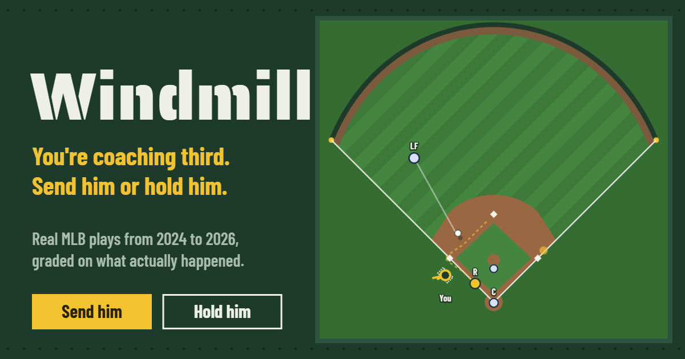
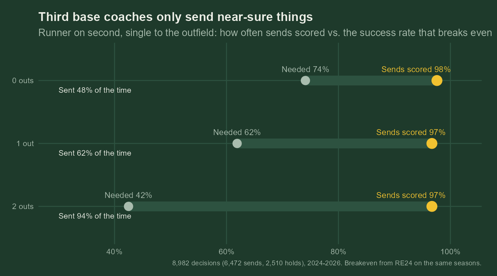

# Windmill: a third base coach simulator

A runner is rounding third on a base hit. You have five seconds. Send him or hold him.

Play it at [gearity.github.io/windmill](https://gearity.github.io/windmill/).

Every play is a real MLB play from 2024 to 2026, postseason included, where the third base coach waved the runner home from second on a single to the outfield. You watch it develop on an animated field, make the call as he nears third, then see what actually happened and watch the broadcast clip. String together as many right calls as you can.



## How a play is graded

| Your call | What really happened | Streak |
|---|---|---|
| Send | Safe | Continues |
| Hold | Out at the plate | Continues |
| Send | Out at the plate | Over |
| Hold | Safe | Over |
| Clock runs out | Either | Over |

Coaches mostly send when it's safe, so the game deals safe and out plays 50/50. Otherwise you could send every time and never lose.

The streak is graded on the result. A timing model grades the decision. It compares the runner's time to the plate (from his Statcast sprint speed) with the ball's (from where it was fielded and the outfielder's Statcast arm strength), turns the gap into a chance he scores, and compares that with the breakeven for the number of outs from a run expectancy (RE24) table. The reveal also ranks the play against every real send by how risky the model thought it was.

## What the data says

From 8,982 real decisions in 2024 to 2026 (runner on second, third base open, single to the outfield):



Third base coaches only send near-sure things. With nobody out they send 48% of the time, and those sends score 97.6%, against a breakeven of 74%. With two outs they send 94% of the time and score 96.7%, against a breakeven of 43%. When sends clear breakeven by that much, coaches are holding runners who would usually have scored.

In a logistic regression on the pieces of the timing model, two things separate the 3% of sends thrown out at home: the runner's time to the plate and how fast the ball reached the outfielder. The outfielder's arm strength and throw distance don't, once coaches have already decided whom to send. Two-out sends are riskier.

Calibrated on 6,472 sends (204 outs), the model picks the thrown-out runner as the riskier send 66% of the time on plays it wasn't fit on, and its probabilities are well calibrated. Because nearly every send scores, it barely beats guessing the league rate: Brier score 0.0304 against 0.0305. The charts and tables are in `pipeline/out/`.

## Running it

It's a static site with no build step. Double-click `index.html`, or serve the folder with any static server. GitHub Pages serves it from the `main` branch, so every push redeploys the site.

## The leaderboard

Finished streaks go to a shared leaderboard (`leaderboard.html`) stored in a free Supabase project. To set up your own:

1. Create a Supabase project and run `supabase/schema.sql` in its SQL editor.
2. Put the project URL and its publishable (anon) key in `js/config.js`.

The key is public by design. The database lets anyone add a streak and read the board, and nothing else. Names aren't verified. With `js/config.js` left empty, the game runs without a leaderboard and the links to it stay hidden.

## Rebuilding the data

Requires R 4.1 or later with:

```r
install.packages(c("dplyr", "purrr", "stringr", "readr", "tidyr", "jsonlite", "httr2", "ggplot2"))
```

From the repo root:

```bash
Rscript pipeline/run.R
```

The first run downloads Statcast, about 5,000 MLB game feeds and the Savant leaderboards, which takes around 40 minutes. Everything is cached in `pipeline/cache/`, so reruns take two. Seasons and pool size are set in `pipeline/config.R`.

| Step | File | What it does |
|---|---|---|
| 1 | `01_statcast.R` | Pulls every plate appearance from Baseball Savant in 4-day chunks, computes RE24, and finds singles to the outfield with a runner on second and third base open |
| 2 | `02_feeds.R` | Reads the MLB game feed for each play to see what the runner from second did: scored, thrown out at home by the outfielder, or held at third |
| 3 | `03_players.R` | Joins that season's Statcast sprint speed and outfield arm strength |
| 4 | `04_fit.R` | Calibrates the timing model with a logistic regression, cross-validates it, and compares real coaches with breakeven |
| 5 | `05_clips.R` | Picks the play pool and finds each play's broadcast clip on Baseball Savant |
| 6 | `06_write.R` | Writes `data/plays.js` and the CSVs in `pipeline/out/` |

Labels come from the game feed's runner movements. The play description can't tell a runner from second apart from a runner from first, or a rundown from a throw home. `pipeline/out/label_check.csv` lists the six plays where the two disagree; in all six a trailing runner was thrown out at home while the runner from second scored.

Clips stream from MLB's servers in the visitor's browser, and nothing is rehosted. A clip saved by hand as `clips/<play_id>.mp4` takes priority.

## Files

```
index.html, leaderboard.html   the two pages
css/, js/                      styles and scripts (model.js, store.js, field.js, game.js, leaderboard.js)
js/config.js                   Supabase URL and public key for the leaderboard
data/plays.js                  generated play data, RE24, and the fitted model
pipeline/                      R data pipeline; out/ holds the analysis tables and charts
supabase/schema.sql            leaderboard database setup
clips/                         optional hand-saved clips
```

Built by Jacob Gearity. Data from MLB Statcast via Baseball Savant and the MLB Stats API. Not affiliated with MLB.
